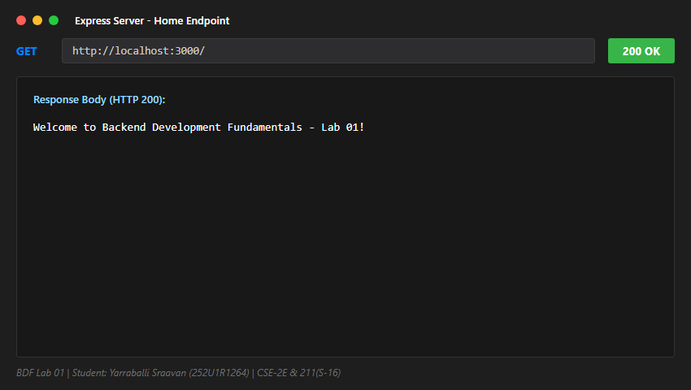
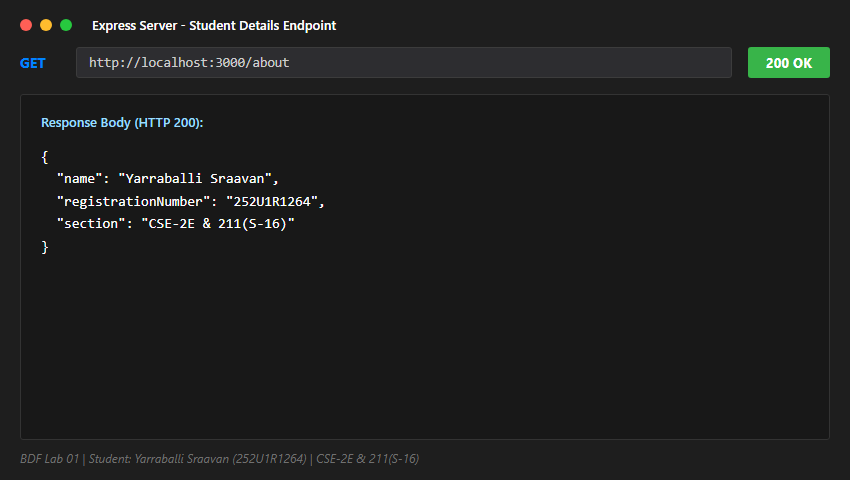
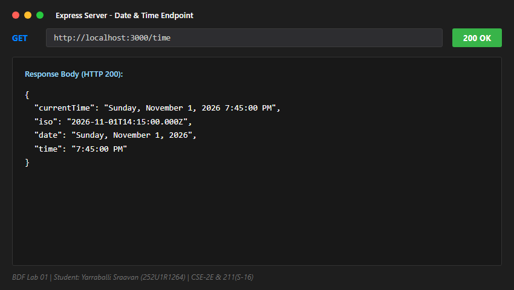
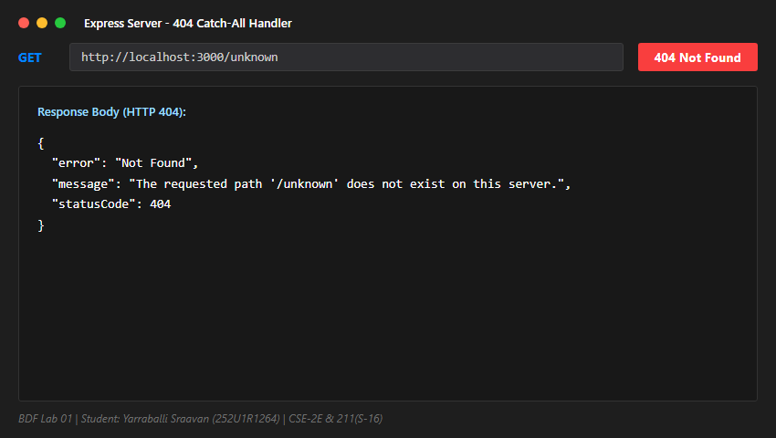

# Lab 1: Node.js and Express server

**Course:** Backend Development Fundamentals (Year II Term II)  
**Faculty:** YUGUNDHAR  
**Department:** Computer Science & Engineering  

---

## Student Details

- **Name:** Yarraballi Sraavan
- **Registration Number:** 252U1R1264
- **Section:** CSE-2E & 211(S-16)

---

## Live Link

- **Live URL:** `Not applicable (Local Development Environment)`
- **Deployment Status:** The application runs locally on `http://localhost:3000`. Full endpoint test outputs, response bodies, and visual response captures are documented in the [Screenshots](#screenshots) section below.

---

## Lab Objective

The objective of this lab is to understand the fundamentals of server-side JavaScript using Node.js and build a web server. We explore the transition from Node's built-in `http` module to the Express.js framework, implement RESTful routing with appropriate HTTP response status codes (200 OK and 404 Not Found), return structured JSON and plain text responses, and configure project dependencies with `npm`.

---

## Technologies Used

- **Node.js** (v24+ / v18+ LTS) – JavaScript runtime environment executing code outside the browser.
- **Express.js** (v4.x) – Fast, unopinionated, minimalist web framework for Node.js.
- **JavaScript (ES6+)** – Modern syntax including arrow functions, destructuring, and object literals.
- **npm** (Node Package Manager) – Dependency and package management.

---

## Explanation of `package.json` Fields

As part of the initial `npm init` setup, the `package.json` file serves as the manifest for our Node.js project:

- **`name`**: The unique identifier of the project or package (`"lab-01"`).
- **`version`**: The current semantic version of the application (`"1.0.0"`).
- **`description`**: A concise summary of the project purpose.
- **`main`**: The primary entry point file of the application (`"server.js"`).
- **`scripts`**: Command-line shortcuts; `"start": "node server.js"` allows launching the server via `npm start`.
- **`keywords`**: Search tags describing the application for package registries.
- **`author`**: Identifies the student/author of the project (`"Yarraballi Sraavan"`).
- **`license`**: Specifies the open-source license governing usage (`"ISC"`).
- **`dependencies`**: Lists external production packages required to run the server (e.g., `"express": "^4.21.2"`).

---

## Architecture: From `http` to Express.js

1. **Plain `http.createServer`**:
   Node's built-in module provides low-level request handling (`req.url`, `req.method`) requiring manual URL parsing, header writing (`res.writeHead`), and response ending.
2. **Express.js (`express()`)**:
   Express abstracts boilerplate by providing a robust middleware pipeline, intuitive route matching (`app.get('/', ...)`), automatic content-type negotiation, and helper functions like `res.status(200).json(...)`.

---

## Installation

Follow these steps to set up the project locally:

1. Clone or download the repository:
   ```bash
   git clone https://github.com/sraavan09-cmd/BDF-LAB01-.git
   ```

2. Open the project folder and navigate to the `lab-01` directory:
   ```bash
   cd BDF-LAB01-/lab-01
   ```

3. Install all required dependencies:
   ```bash
   npm install
   ```

---

## Execution

### Run the Express.js Web Server (Primary)
1. Start the Express server:
   ```bash
   npm start
   ```

2. The terminal will display the active server listener message:
   ```text
   Server is running successfully on http://localhost:3000
   Press Ctrl+C to stop the server.
   ```

### Run the Plain HTTP Server (Task 3 Demo)
To test the baseline built-in `http.createServer` implementation:
```bash
npm run start:http
```

### Accessing Endpoints
Open your web browser or API client (Postman / Thunder Client / cURL) and navigate to:
```
http://localhost:3000/
```

> **Optional Environment Variable:**
> By default, the application runs on port `3000`. You can configure a custom port via an environment variable without modifying code:
> ```bash
> PORT=4000 npm start
> ```

---

## API Endpoints

| Method | Endpoint | Description | Status Code | Response Format |
|:-------|:---------|:------------|:-----------:|:----------------|
| **GET** | `/` | Returns welcome message | `200 OK` | Text / Plain |
| **GET** | `/about` | Returns student name, registration number, and section | `200 OK` | JSON |
| **GET** | `/time` | Returns current server date and time using JavaScript `new Date()` | `200 OK` | JSON |
| **GET** | `/date` | Returns today's date formatted as text | `200 OK` | Text / Plain |
| **GET** | *Any unknown route* | Handles undefined routes with 404 error handler | `404 Not Found` | JSON |

### Sample Response Payloads

- **GET `/`**
  ```text
  Welcome to Backend Development Fundamentals - Lab 01!
  ```

- **GET `/about`**
  ```json
  {
    "name": "Yarraballi Sraavan",
    "registrationNumber": "252U1R1264",
    "section": "CSE-2E & 211(S-16)"
  }
  ```

- **GET `/time`**
  ```json
  {
    "currentTime": "Sun Nov 01 2026 15:41:58 GMT+0530 (India Standard Time)",
    "iso": "2026-11-01T10:11:58.596Z",
    "date": "Sun Nov 01 2026",
    "time": "3:41:58 PM"
  }
  ```

- **GET `/date`**
  ```text
  Today's date is Sun Nov 01 2026 16:34:00 GMT+0530 (India Standard Time)
  ```

- **GET `/unknown` (404 Error Handler)**
  ```json
  {
    "error": "Not Found",
    "message": "The requested path '/unknown' does not exist on this server.",
    "statusCode": 404
  }
  ```

---

## Screenshots

The screenshots below demonstrate the successful execution and HTTP responses for every route:

### 1. Home Route (`GET /`)


### 2. About Route (`GET /about`)


### 3. Time Route (`GET /time`)


### 4. Unknown Route (`GET /unknown`)


### Manual Capture Verification URLs
To test and capture manual screenshots via your browser or Postman, launch the server and visit:
- Root Route: `http://localhost:3000/`
- About Route: `http://localhost:3000/about`
- Time Route: `http://localhost:3000/time`
- Unknown Route: `http://localhost:3000/unknown`

---

## Notes & Troubleshooting

During development, the following challenges were identified and addressed:

1. **Missing `node_modules` or Express package:**
   - *Problem:* Running `node server.js` before installation triggers `Error: Cannot find module 'express'`.
   - *Solution:* Executed `npm install express` which resolves the dependency tree and adds Express to `package.json` under `dependencies`.
2. **Port Conflict (EADDRINUSE):**
   - *Problem:* If port `3000` is already in use by another running service, the server crashes with `Error: listen EADDRINUSE: address already in use :::3000`.
   - *Solution:* Implemented dynamic port binding using `const PORT = process.env.PORT || 3000;`, enabling port override via environment variables (e.g., `PORT=5000`).
3. **Repository Cleanliness and Git Safety:**
   - *Problem:* `node_modules/` contains thousands of third-party files that should never be pushed to version control.
   - *Solution:* Created a comprehensive `.gitignore` file including `node_modules/` and `.env` to prevent accidental commits of external packages or secrets.
4. **Handling Unmatched Paths (404 Handling):**
   - *Problem:* Default Express 404 response returns an HTML error page (`Cannot GET /xyz`), which is inconsistent with JSON APIs.
   - *Solution:* Added an `app.use((req, res) => ...)` catch-all middleware at the bottom of the middleware chain that explicitly sets status `404` and returns a clean `{ "error": "Route not found" }` JSON response.

---

## Viva Preparation

### 1. What is the difference between `package.json` and `node_modules`?
- **`package.json`**: A lightweight metadata manifest file checked into Git. It records project details, author information, scripts (e.g., `npm start`), and the exact list of dependency package names and version ranges.
- **`node_modules`**: The physical directory generated by `npm install` containing the downloaded compiled JavaScript code and binaries for all dependencies and sub-dependencies. It is excluded from version control via `.gitignore` because it can be rebuilt at any time using `npm install`.

### 2. What does `app.listen()` do?
`app.listen(port, [callback])` binds the Express application to a specific network port (e.g., 3000) on the host machine and starts an HTTP server to listen for incoming client network requests. The optional callback function executes once the server has successfully bound to the port and is ready to receive requests.

### 3. What do `request` (`req`) and `response` (`res`) represent?
- **`req` (Request Object):** An instance representing the incoming HTTP request sent by the client (browser, Postman, mobile app). It encapsulates client data such as URL parameters (`req.params`), query strings (`req.query`), HTTP headers (`req.headers`), and the request body (`req.body`).
- **`res` (Response Object):** An instance representing the outgoing HTTP response sent back to the client. It provides methods to set HTTP status codes (`res.status(200)`), attach response headers, and transmit data back to the client (`res.send()`, `res.json()`, `res.sendFile()`).

